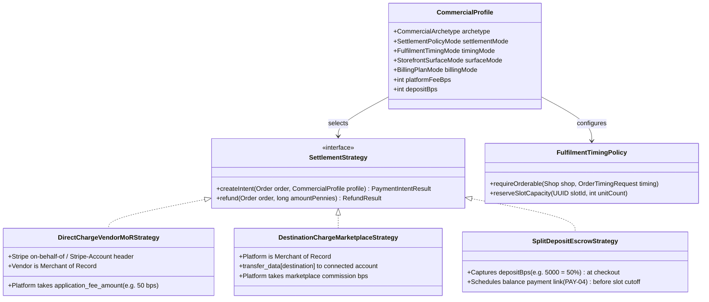
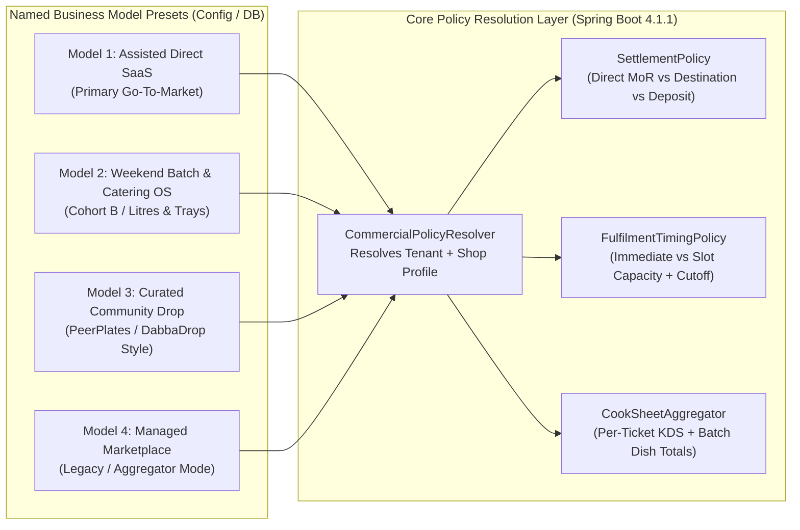

# ADR-0007: Malleable Multi-Model Commercial, Settlement & Fulfilment Policy Engine

- **Status:** Proposed / Accepted for Phase 30 & Post-v2.3 Commercial Evolution (2026-10-17)
- **Deciders:** J'Toye engineering & product strategy (owner decision, 2026-10-17)
- **Tracking:** Extends [ADR-0001](ADR-0001-onboarding-approval-and-stripe-money-flow.md) (#102, #178), Phase 30 (`PAY-01`..`PAY-04`), Cohort B discovery (#428), and WhatsApp channel seam (#208)
- **Related:**
  - [`docs/analysis/BUSINESS_MODEL_DECISION_GUIDE.md`](../../analysis/BUSINESS_MODEL_DECISION_GUIDE.md)
  - [`core-java/src/main/java/uk/jtoye/core/onboarding/OnboardingModel.java`](../../../core-java/src/main/java/uk/jtoye/core/onboarding/OnboardingModel.java)
  - [`core-java/src/main/java/uk/jtoye/core/payment/StripeConnectService.java`](../../../core-java/src/main/java/uk/jtoye/core/payment/StripeConnectService.java)
  - [`core-java/src/main/java/uk/jtoye/core/payment/PaymentService.java`](../../../core-java/src/main/java/uk/jtoye/core/payment/PaymentService.java)
  - [`core-java/src/main/java/uk/jtoye/core/storefront/ShopAvailabilityPolicy.java`](../../../core-java/src/main/java/uk/jtoye/core/storefront/ShopAvailabilityPolicy.java)
  - [`core-java/src/main/java/uk/jtoye/core/order/FulfilmentPolicy.java`](../../../core-java/src/main/java/uk/jtoye/core/order/FulfilmentPolicy.java)

---

## 1. Context & Problem Statement

In [ADR-0001](ADR-0001-onboarding-approval-and-stripe-money-flow.md), J'Toye OaaS introduced a two-value enum, `OnboardingModel` (`MARKETPLACE` vs. `WHITE_LABEL`), to govern two decisions:
1. Whether a vendor application auto-approves once mandatory compliance gates (`BUSINESS_VERIFIED`, `FOOD_HYGIENE_RATING`, `ALLERGEN_DATA_COMPLETE`, `TRADER_IDENTITY`) pass; and
2. How Stripe Connect routes card payments (`MARKETPLACE` → destination charges on the platform account; `WHITE_LABEL` → direct charges on the vendor's connected account).

While that binary split was sufficient for the initial Phase 18 onboarding slice, our UK African food market analysis and codebase audit (at Schema **V86**) revealed three structural tensions:

1. **Go-To-Market Reality vs. Current Payment Routing:**
   Our highest-probability commercial wedge (`78%–85%` projected survival/success) is **Assisted Direct-Order & Scheduled Fulfilment Vertical SaaS** where the **Vendor is the legal Merchant of Record (MoR)** (`£39/location/month + 0.5% GTV`). However, `StripeConnectService.resolveDestinationAccount` (`StripeConnectService.java:170-198`) currently routes connected-account payments **only** for `MARKETPLACE` tenants (via destination charges where J'Toye is MoR), leaving `WHITE_LABEL` tenants on a single-account fallback.
2. **Dual-Rhythm Kitchen Operations (Counter Takeaway + Scheduled Batch/Catering):**
   Established UK West African food operators rarely operate purely on-demand *or* purely as caterers. The same kitchen often runs **immediate counter/delivery service** (`Cohort A`) during evening/weekday windows and **advance batch pre-orders** (`Cohort B` — weekend 2L/4L soup bowls, party jollof coolers, and catering trays with cut-off times and prep deposits). Currently, `ShopAvailabilityPolicy.requireTakingOrders` (`ShopAvailabilityPolicy.java:234-242`) enforces immediate open-now trading only (`openNow == true`), blocking customers from placing advance pre-orders for Saturday when browsing on a Wednesday night.
3. **Future Business Model Extensibility Without Rewrites:**
   As J'Toye OaaS scales beyond its initial London cluster, we want to support additional commercial archetypes — such as **Curated Weekly Batch Drops** (PeerPlates / DabbaDrop / HomeCooks style), **Pay-As-You-Go Weekend Kitchens** (higher transaction fee, `£0` base subscription), and **Community/Agency White-Label Resellers** — without littering `PaymentService`, `PublicStorefrontService`, `OrderService`, and `ShopAvailabilityPolicy` with brittle `if (model == ...)` branches or invasive database rewrites.

---

## 2. Decision: Decompose "Business Model" into Four Orthogonal Policy Axes

Instead of overloading `OnboardingModel` with every commercial permutation, we follow the established house pattern of `FulfilmentPolicy` (`core-java/src/main/java/uk/jtoye/core/order/FulfilmentPolicy.java`) and `ShopAvailabilityPolicy` (`core-java/src/main/java/uk/jtoye/core/storefront/ShopAvailabilityPolicy.java`):

> **A "Business Model" in J'Toye OaaS is a named preset (`CommercialArchetype`) composed of four orthogonal, server-authoritative policy axes evaluated at runtime per tenant and per shop.**

### Axis 1: Settlement & Merchant-of-Record Policy (`SettlementPolicyMode`)

Governs who the legal seller/MoR is on the card transaction and how `PaymentService` constructs the Stripe `PaymentIntent`:

| Mode | Legal Merchant of Record (MoR) | Stripe Connect Mechanics | Target Use Case |
| :--- | :--- | :--- | :--- |
| **`DIRECT_CHARGE_VENDOR_MOR`** *(Default Go-To-Market)* | **The Vendor** ( verified via `V71` `trader_identity`) | `PaymentIntent.create(params, RequestOptions.builder().setStripeAccount(vendorStripeAccountId).build())` with `application_fee_amount = round(total * platformFeeBps / 10000)`. Stripe processing fees (`1.5% + 20p`) are deducted directly on the vendor's connected account. | Assisted Direct-Order Vertical SaaS (`WHITE_LABEL` / Direct Storefront). J'Toye never touches customer funds and carries zero food-liability or chargeback exposure. |
| **`DESTINATION_CHARGE_PLATFORM_MOR`** *(Shipped in #102)* | **J'Toye Platform** | `PaymentIntent.create` on J'Toye's platform account with `transfer_data[destination] = vendorStripeAccountId` and `application_fee_amount`. | Managed Marketplace (`MARKETPLACE`) or curated multi-vendor campaigns where J'Toye provides unified customer support and settlement. |
| **`SPLIT_DEPOSIT_VENDOR_MOR`** | **The Vendor** | Direct charge capturing `depositBps` (e.g. `5000` = 50%) on order creation (`PaymentStatus.PARTIALLY_PAID`), stamping `deposit_amount_pennies` and `balance_due_pennies`. Dispatches a single-use payment link (`PAY-04`) to the customer's verified phone/email before the prep cut-off. | Cohort B Catering, Event Trays, and High-Value Weekend Batch Coolers (`£100+`). Protects the kitchen against ingredient-purchase defaults. |

### Axis 2: Fulfilment Timing & Capacity Policy (`FulfilmentTimingMode`)

Extends `ShopAvailabilityPolicy` (`V80`) and `FulfilmentPolicy` (`V83`) so a shop can accept orders for **now**, **a scheduled future slot**, or **both**:

| Mode | Checkout Gate Behaviour | Capacity Control | Target Use Case |
| :--- | :--- | :--- | :--- |
| **`IMMEDIATE_ONLY`** *(Current V80 behaviour)* | Calls `ShopAvailabilityPolicy.requireTakingOrders(shop)` (`openNow == true`). Refuses with `409 shop-closed` when paused or outside `opening_schedule`. | Governed by live kitchen pause (`orders_paused_until` / `orders_paused_indefinitely`) and `OrderLimits` (`V81`). | Pure walk-in / on-demand evening takeaways. |
| **`SCHEDULED_SLOTS_ONLY`** | Allows checkout 24/7 (even when `openNow == false`) **provided** the request carries a valid `scheduledSlotId` whose `cutoff_at > now` and whose atomic `reserved_units + order.unitCount <= max_units`. | Per-slot capacity (`max_orders`, `max_units`) in `shop_fulfilment_slots` (`V87`) with `SELECT ... FOR UPDATE` or optimistic `@Version`. | Weekend batch prep kitchens (PeerPlates / DabbaDrop style), Friday/Saturday soup litre drops, and pop-up kitchens. |
| **`HYBRID_IMMEDIATE_AND_SLOTS`** *(Recommended UK West African Default)* | Accepts `IMMEDIATE` orders when `openNow == true`, **and** accepts `SCHEDULED` orders 24/7 against published future `shop_fulfilment_slots`. When `openNow == false`, the storefront defaults the picker to `"Pre-Order for Next Available Slot"` instead of dead-ending the buyer. | Live pause governs `IMMEDIATE` orders; slot caps govern `SCHEDULED` orders independently. | Established UK West African restaurants/takeaways that serve daily meals *and* weekend batch bowls/catering trays. |

### Axis 3: Discovery & Storefront Surface Policy (`StorefrontSurfaceMode`)

Controls how a tenant's shops appear on public routes (`/`, `/shop`, `/shop/[slug]`):

| Mode | `/shop/[slug]` Behaviour | `/shop` Directory & Postcode Search | Target Use Case |
| :--- | :--- | :--- | :--- |
| **`DEDICATED_ONLY`** | Full branded storefront with `V86` 301 slug aliases; zero cross-tenant links. | Excluded from cross-tenant directory browsing (`directory_listed = false`); reachable only via direct link, QR code, or WhatsApp bridge. | Pure white-label operators who want zero competitor adjacency. |
| **`DIRECT_PLUS_LOCAL_DIRECTORY`** *(Default)* | Full branded storefront where the vendor's repeat customers land directly. | Included in `GET /public/shops?lat=&lon=&radiusKm=` (`V61` OS Code-Point Open haversine search) as a free incremental discovery bonus. | Standard J'Toye SaaS operators who own their direct traffic but welcome zero-commission local postcode discovery. |
| **`CURATED_CAMPAIGN_DROP`** | Renders countdown timer to `cutoff_at`, live portion scarcity badge (`"8 of 25 portions left"`), and fixed collection/delivery window. | Featured in scheduled batch/catering collections. | Weekly rotating menu drops, festival specials (Eid, Christmas, Owambe), or supper-club style kitchens. |

### Axis 4: Platform Monetisation & Billing Policy (`BillingPlanMode`)

Extends `TenantPlan` (`V48` `STANDARD | PREMIUM | INTERNAL`) with explicit fee parameters stored on the commercial profile so pricing experiments require **zero code changes**:

| Plan Preset | Monthly Base Fee | Platform Application Fee (`platformFeeBps`) | Onboarding Fee | Target Cohort |
| :--- | ---: | ---: | ---: | :--- |
| **`SAAS_HYBRID_STANDARD`** | `£39 / location / mo` | `50 bps` (`0.5%` of direct GTV) | `£99` assisted | Primary Go-To-Market (`£5k–£25k/mo` direct GTV takeaways & caterers). |
| **`SAAS_FLAT_PREDICTABLE`** | `£99 / location / mo` (`£149` high-volume) | `0 bps` (`0%` platform fee; pass-through Stripe only) | `£99` assisted | Operators who strongly prefer fixed monthly software bills over percentage metering. |
| **`BATCH_PAYG_STARTER`** | `£0 / mo` | `600 bps` (`6.0%` of direct GTV) | `£49` self/assisted | Weekend-only batch kitchens or seasonal caterers validating demand before committing to a monthly retainer. |
| **`PARTNER_RESELLER_WHITELABEL`** | Wholesale per-seat tier | Configurable rev-share bps | Partner-delivered | Community associations or culinary incubators onboarding `10–20+` kitchens. |

---

## 3. How New Business Models Are Defined Without Code Rework

Because the four axes are orthogonal, introducing or switching a business model is a **data configuration**, not a code branch:

| Business Model Archetype | `SettlementPolicyMode` | `FulfilmentTimingMode` | `StorefrontSurfaceMode` | `BillingPlanMode` | Code Changes Required to Activate? |
| :--- | :--- | :--- | :--- | :--- | :--- |
| **1. Assisted Direct-Order SaaS** *(Primary GTM)* | `DIRECT_CHARGE_VENDOR_MOR` | `HYBRID_IMMEDIATE_AND_SLOTS` | `DIRECT_PLUS_LOCAL_DIRECTORY` | `SAAS_HYBRID_STANDARD` (`£39 + 0.5%`) | **None** once policy engine lands |
| **2. Catering & Weekend Batch Ledger** *(Cohort B)* | `SPLIT_DEPOSIT_VENDOR_MOR` | `SCHEDULED_SLOTS_ONLY` | `DIRECT_PLUS_LOCAL_DIRECTORY` | `SAAS_HYBRID_STANDARD` or `SAAS_FLAT_PREDICTABLE` | **None** (profile toggle) |
| **3. Weekend Pop-Up / Batch Drop** *(PeerPlates / DabbaDrop style)* | `DIRECT_CHARGE_VENDOR_MOR` | `SCHEDULED_SLOTS_ONLY` | `CURATED_CAMPAIGN_DROP` | `BATCH_PAYG_STARTER` (`£0 + 6%`) | **None** (profile toggle) |
| **4. Pure White-Label Enterprise Group** | `DIRECT_CHARGE_VENDOR_MOR` | `HYBRID_IMMEDIATE_AND_SLOTS` | `DEDICATED_ONLY` | `SAAS_FLAT_PREDICTABLE` (`£149/mo`) | **None** (profile toggle) |
| **5. Curated Local Marketplace** | `DESTINATION_CHARGE_PLATFORM_MOR` | `HYBRID_IMMEDIATE_AND_SLOTS` | `DIRECT_PLUS_LOCAL_DIRECTORY` | Commission via `platformFeeBps` | **None** (uses existing `#102` destination flow) |

---

## 4. Database & Domain Implementation Plan (`V87+`)

To preserve full backward compatibility with all **86 existing Flyway migrations (`V1`–`V86`)** and all **6,158+ logical test invocations**:

1. **Keep `OnboardingModel` (`MARKETPLACE | WHITE_LABEL`) Intact for V43 Compatibility:**
   - Do not break existing `vendor_onboarding.model` CHECK constraints or tests.
   - Map `WHITE_LABEL` default to `DIRECT_CHARGE_VENDOR_MOR` once the tenant's Stripe Connect account is `ENABLED`, and `MARKETPLACE` to `DESTINATION_CHARGE_PLATFORM_MOR`.
2. **Additive Flyway Migration (`V87__scheduled_fulfilment_slots_and_commercial_profile.sql`):**
   - **`shop_fulfilment_slots` table (ENABLE + FORCE RLS via `current_tenant_id()`):**
     - `id UUID PRIMARY KEY`, `tenant_id UUID NOT NULL`, `shop_id UUID NOT NULL REFERENCES shops(id) ON DELETE CASCADE`
     - `service_date DATE NOT NULL`, `window_start TIME NOT NULL`, `window_end TIME NOT NULL`
     - `cutoff_at TIMESTAMPTZ NOT NULL` (orders refused after this instant)
     - `max_orders INT`, `max_units INT`, `reserved_orders INT NOT NULL DEFAULT 0`, `reserved_units INT NOT NULL DEFAULT 0`
     - `deposit_bps INT NOT NULL DEFAULT 10000` (`10000` = 100% upfront; `5000` = 50% catering deposit)
     - `version BIGINT NOT NULL DEFAULT 0` (`@Version` optimistic lock to prevent slot overbooking under concurrent checkouts)
   - **Additive columns on `orders` (+ `orders_aud` Envers mirrors):**
     - `fulfilment_slot_id UUID REFERENCES shop_fulfilment_slots(id)` (NULL = immediate order)
     - `scheduled_for_date DATE`, `scheduled_window_label VARCHAR(64)` (snapshot at order time, mirroring V30 `product_name` and V63 `allergen_mask` snapshots so a later slot edit never rewrites what the customer bought)
     - `deposit_amount_pennies BIGINT`, `balance_due_pennies BIGINT` (NULL = standard single-payment order)
   - **Additive columns on `shops` (+ `shops_aud` mirrors):**
     - `fulfilment_timing_mode VARCHAR(32) NOT NULL DEFAULT 'IMMEDIATE_ONLY'` (`IMMEDIATE_ONLY | SCHEDULED_SLOTS_ONLY | HYBRID_IMMEDIATE_AND_SLOTS`)
3. **Consolidated Kitchen "Cook Sheet" Read Projection (`OrderCookSheetService`):**
   - Pure read-side aggregation query (`GROUP BY product_id, product_name, allergen_mask`) over `orders` + `order_items` filtered by `(tenant_id, shop_id, scheduled_for_date, fulfilment_slot_id)` and active statuses (`CONFIRMED`, `PREPARING`, `READY`).
   - Requires **zero new tables** and gives batch/catering kitchens an instant production tally (`"38x Jollof Rice Large, 14x Egusi 2L Bowl, 6x Suya Platter"`) plus combined PPDS label batch printing (`AllergenLabelPdfService`).

---

## 5. Consequences & Invariants

- **RLS Non-Negotiable:** `shop_fulfilment_slots` MUST carry `ENABLE ROW LEVEL SECURITY` and `FORCE ROW LEVEL SECURITY` pinned to `current_tenant_id()`, with a `NOSUPERUSER NOBYPASSRLS` integration test (`RlsContractTest` will fail the build otherwise).
- **Server-Authoritative Pricing & Capacity:** Just as `FulfilmentPolicy.deliveryFeePennies` never trusts client-calculated fees, `FulfilmentTimingPolicy` and `SettlementStrategy` compute slot cut-offs, unit capacity, and deposit splits strictly on the server inside the order-creation transaction.
- **Historical Snapshot Integrity:** `orders.scheduled_window_label` and `orders.scheduled_for_date` are snapshotted at checkout time (`V63` precedent) so vendor edits to future slot templates never mutate historical orders.
